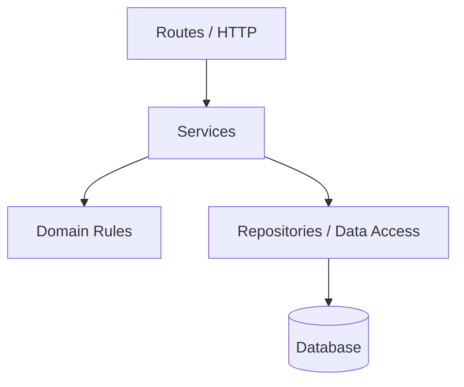
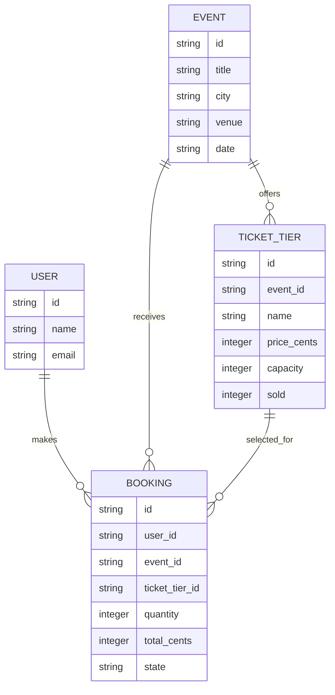
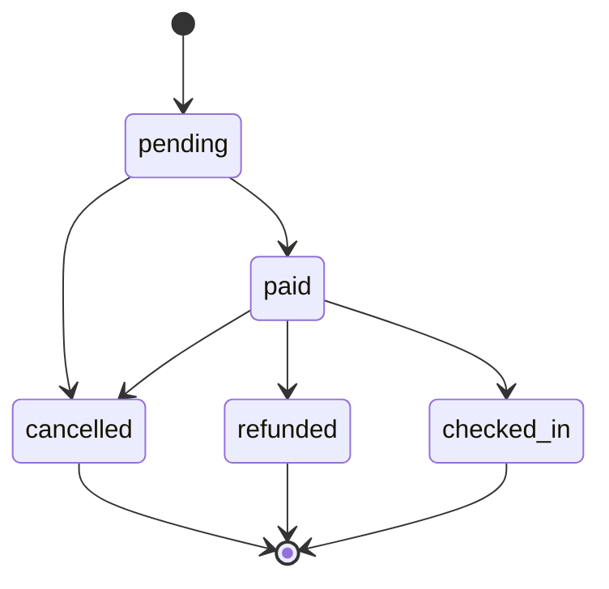

# Event Ticketing and Booking — Architecture

## 1. Layer architecture

- **Routes:** May handle HTTP requests, parameters, and responses. Must not contain business rules or access the database directly.

- **Services:** May coordinate operations and apply business workflows. Must not handle HTTP details or bypass the domain rules.

- **Domain rules:** May validate business rules and calculate outcomes. Must not depend on HTTP, services, or database implementation details.

- **Repositories:** May read and write stored data. Must not make HTTP responses or decide business workflows.

Dependencies flow downward; higher layers must not be called by lower layers.

## 2. Data model

This diagram describes the proposed relationships between users, events, ticket tiers, and bookings. It does not mean that user management or database persistence has already been implemented.

## 3. Booking life cycle

Allowed transitions:

- `pending` → `paid`
- `pending` → `cancelled`
- `paid` → `checked_in`
- `paid` → `refunded`
- `paid` → `cancelled`

The final states are `cancelled`, `refunded`, and `checked_in`. No transitions are allowed out of these states.
